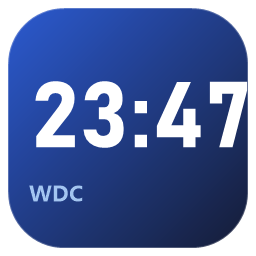
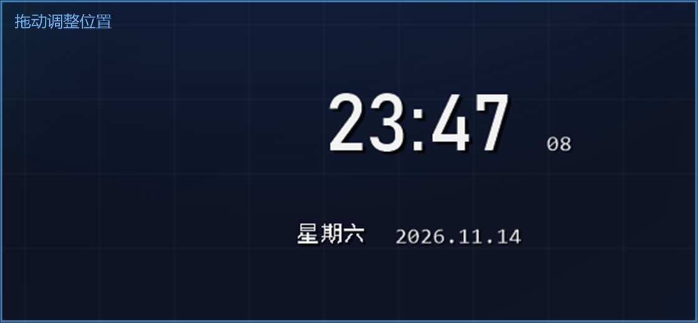
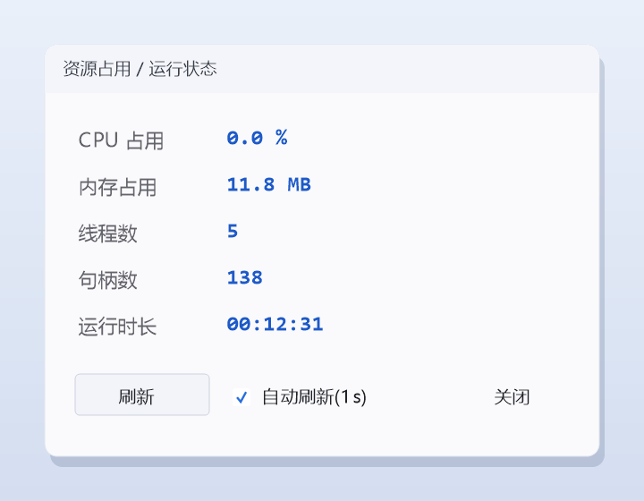
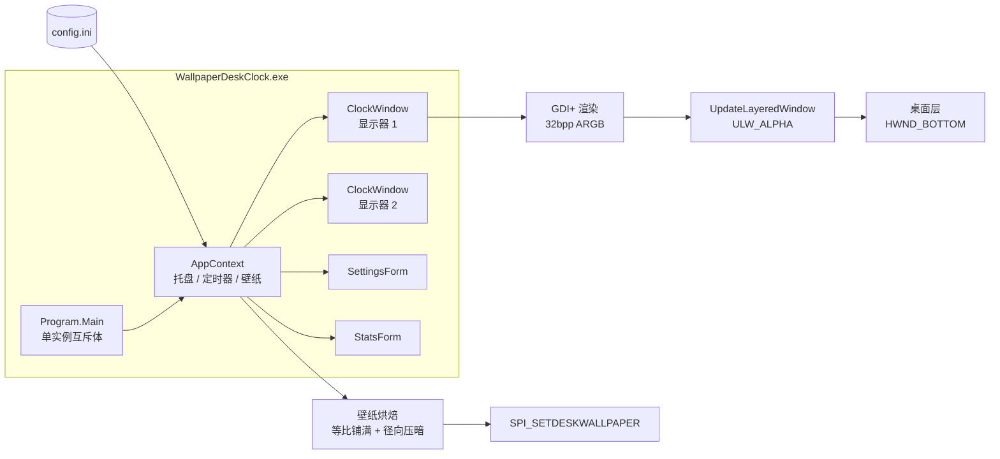
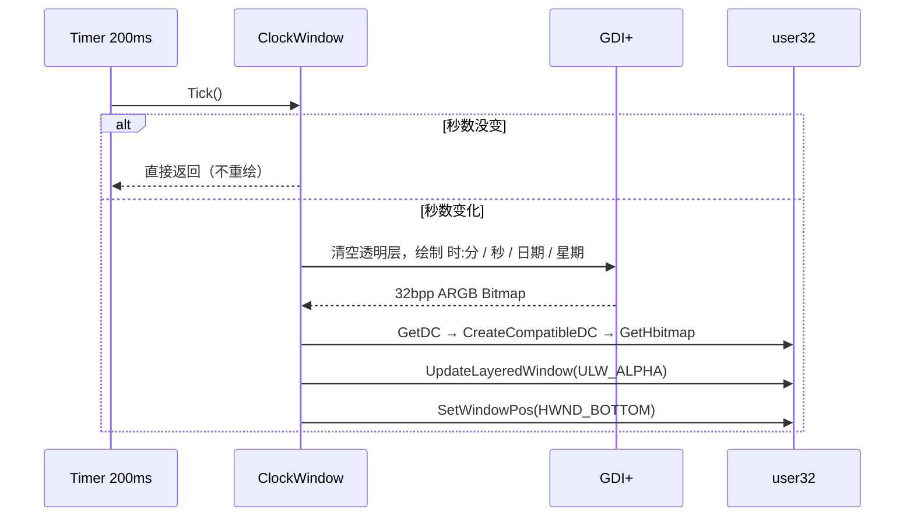

<div align="center">



# 壁纸桌面时钟 · WallpaperDeskClock

**把时间和日期真正画进桌面壁纸 —— 34 KB、零依赖、点击穿透的 Windows 桌面时钟**

[](#-快速开始)
[](#-源码编译)
[](#-为什么这么小)
[](#-为什么这么小)
[](LICENSE)
[](https://github.com/xkzm123/WallpaperDeskClock/stargazers)

[效果预览](#-截图) · [快速开始](#-快速开始) · [配置详解](#-配置详解) · [工作原理](#-工作原理) · [常见问题](#-常见问题)

</div>


---

## 📖 这是什么

桌面时钟满地都是，但绝大多数要么占着一块**不透明的窗口**，要么**挡住图标和右键菜单**，要么为了动画**常驻吃 GPU**。

WallpaperDeskClock 换了个思路：时钟不是「窗口」，而是一层**分层透明窗口（layered window）**。

- 用 GDI+ 把「时:分 / 秒 / 日期 / 星期」画成一张 32bpp ARGB 位图；
- 用 `UpdateLayeredWindow` 以 `ULW_ALPHA` 逐像素推送，**真透明**、边缘抗锯齿，不是抠色；
- 窗口 Z 序钉在 `HWND_BOTTOM`，并带上 `WS_EX_TRANSPARENT | WS_EX_NOACTIVATE | WS_EX_TOOLWINDOW` —— **鼠标点击直接穿透到桌面**，不进 Alt+Tab，不抢焦点；
- 顺手把壁纸重新烘焙一张（等比铺满 + 右下角径向压暗），保证**任何壁纸下文字都清楚**。

结果就是：它看起来像壁纸的一部分，而不是一个趴在桌面上的程序。

```text
34 KB 单文件 exe   ·   常驻内存约 12 MB   ·   空闲 CPU 0.0%   ·   无任何第三方依赖
```

---

## 📸 截图

**桌面效果**（1920×1080，右下角默认位置）


**局部特写**：`HH:mm` + 秒 + 日期 + 星期，带柔和的投影


| 自定义布局模式 | 设置面板 |
| :---: | :---: |
|  |  |
| 勾选后窗口置顶 + 蓝色边框，拖动即定位，取消勾选自动落盘 | 开机自启、显示器选择、布局编辑、字号缩放一站搞定 |

| 资源占用 / 运行状态 |
| :---: |
|  |

> 上图为界面示意，数值取自日常运行区间（内存 ~12 MB，空闲 CPU 0.0%）。

---

## ✨ 特性

| 特性 | 说明 |
| --- | --- |
| 🪟 **真·分层透明** | `UpdateLayeredWindow` + 32bpp ARGB，字体抗锯齿边缘无锯齿、无黑边 |
| 🖱️ **点击穿透** | `WS_EX_TRANSPARENT`，图标、右键菜单、拖选文件全部照常 |
| 🚫 **不抢焦点** | `WS_EX_NOACTIVATE` + `WS_EX_TOOLWINDOW`，不进 Alt+Tab、不打断游戏全屏 |
| 🖥️ **多显示器** | 每块屏一个独立时钟，`all` 或指定第 N 块；拔插显示器 2 秒内自动重建 |
| 📐 **比例坐标布局** | 位置以屏幕百分比存储，换分辨率 / 缩放比例后不跑位 |
| 🎨 **壁纸自动烘焙** | 等比铺满 + 右下角径向压暗（`vignette`），深色浅色壁纸都能看清 |
| 🖐️ **拖动即定位** | 编辑模式拖动，退出编辑自动写回 `config.ini`，无需手改坐标 |
| ⚡ **几乎零开销** | 200 ms 心跳，但**只在秒数变化时重绘**；无动画、无 GPU 渲染 |
| 🔁 **单实例** | 命名互斥体，重复启动直接提示，不会叠出两个时钟 |
| 🧷 **自启自愈** | 移动程序目录后，注册表启动项路径会在下次启动时自动改写 |
| 🧰 **托盘即配置** | 设置 / 资源占用 / 重新应用壁纸 / 恢复默认布局 / 打开配置目录 / 退出 |
| 📦 **零依赖单文件** | 只用 .NET Framework 自带的 WinForms + GDI+，`csc` 一条命令出 exe |

---

## 🚀 快速开始

### 方式一：直接运行（推荐）

1. 到 [Releases](https://github.com/xkzm123/WallpaperDeskClock/releases/latest) 下载 `WallpaperDeskClock.exe`；
2. 和 `config.ini`、`wallpaper.jpg` 放在**同一个目录**；
3. 双击运行，托盘出现图标即生效；
4. 托盘图标 **双击** = 打开设置，**右键** = 全部菜单。

> 不需要安装，不需要管理员权限，`.NET Framework 4.x` 是 Windows 10/11 自带的。

### 方式二：源码编译

```bat
:: 仓库根目录双击，或命令行执行
build.bat
:: 产物：dist\WallpaperDeskClock.exe
```

不想用脚本，一条 `csc` 也能搞定：

```bat
%WINDIR%\Microsoft.NET\Framework64\v4.0.30319\csc.exe /target:winexe /optimize+ ^
  /out:WallpaperDeskClock.exe /win32manifest:src\app.manifest ^
  /r:System.dll /r:System.Drawing.dll /r:System.Windows.Forms.dll ^
  src\Program.cs src\AppContext.cs src\ClockWindow.cs src\Dialogs.cs
```

用 Visual Studio 的话，新建一个 **Windows Forms App (.NET Framework)** 项目，把这 4 个 `.cs` 和 `app.manifest` 丢进去即可。

---

## ⚙️ 配置详解

所有配置都在 `config.ini`，改完在托盘菜单点 **「重新应用桌面壁纸」** 或重启程序生效（设置面板里的改动会即时生效并自动保存）。

### 基础

| 键 | 默认值 | 说明 |
| --- | --- | --- |
| `image` | `wallpaper.jpg` | 背景图路径，相对本目录或绝对路径 |
| `displays` | `all` | `all` = 全部显示器；`0` = 第 1 块；`1` = 第 2 块 |
| `use12h` | `0` | `0` → `HH:mm`；`1` → `hh:mm` |
| `dateformat` | `yyyy.MM.dd` | 任意 .NET 日期格式串，如 `M月d日 ddd` |
| `color` | `#F2F2F2` | 文字颜色，`#RRGGBB` 或 `#AARRGGBB` |
| `shadow` | `1` | 是否绘制投影 |
| `showdate` / `showweek` / `showseconds` | `1` | 分别控制日期 / 星期 / 秒的显示 |

### 壁纸烘焙

| 键 | 默认值 | 说明 |
| --- | --- | --- |
| `vignette` | `1` | 是否把右下角径向压暗烘焙进壁纸 |
| `vignette_alpha` | `78` | 压暗强度（0–255），越大越暗 |

### 布局（一般交给拖动和滑块）

| 键 | 默认值 | 说明 |
| --- | --- | --- |
| `layout.<屏>.x` / `.y` | `0.575` / `0.790` | 时钟窗口左上角占屏幕宽 / 高的比例 |
| `layout.<屏>.scale` | `1.0` | 该屏的整体缩放（设置面板滑块 = 0.50×–2.50×） |
| `rel_right` | `0.831` | 文字右对齐点在窗口内的横向比例 |
| `rel_clock_y` / `rel_date_y` | `0.323` / `0.695` | 时间行 / 日期行的纵向比例 |
| `gap_seconds` | `14` | 秒与分钟之间的横向间距（px） |
| `gap_week` | `26` | 星期与日期之间的横向间距（px） |
| `seconds_dy` | `10` | 秒相对时间行的纵向偏移（px） |

### 字体

| 键 | 默认值 | 说明 |
| --- | --- | --- |
| `font_clock` / `size_clock` | `Bahnschrift` / `64` | 主时间字体与字号（px） |
| `font_date` / `size_date` | `Consolas` / `18` | 日期 |
| `font_week` / `size_week` | `SimHei` / `18` | 星期 |
| `font_seconds` / `size_seconds` | `Consolas` / `18` | 秒 |

> 实际字号 = 基础字号 × `layout.<屏>.scale`。字体缺失时自动回退到 `Segoe UI`。

### 换个壁纸

```ini
image=D:\Pictures\my-wallpaper.jpg
```

程序不会改动你的原图，只会在同目录生成 `_wallpaper_active.jpg`（烘焙后的副本）并设为桌面壁纸。

> 截图里用的演示壁纸是 [`assets/demo-wallpaper.png`](assets/demo-wallpaper.png)，可以直接拿去试效果。

---

## 🧠 工作原理

### 整体结构



### 一次刷新的完整链路



三个关键点：

1. **分层窗口三步曲**：`GetDC(0)` 拿屏幕 DC → `CreateCompatibleDC` + `SelectObject(hBitmap)` → `UpdateLayeredWindow` 带 `BLENDFUNCTION{AC_SRC_OVER, AC_SRC_ALPHA}` 推屏，最后**逐个释放** `SelectObject / DeleteObject / DeleteDC / ReleaseDC`，长时间运行不漏 GDI 句柄。
2. **为什么重绘只在秒变化时**：心跳 200 ms 是为了让秒的跳变看起来不超过 200 ms 延迟，而真正的绘制被 `_lastSec / _lastMin / _lastDay` 三重比较挡住 —— 空闲时 CPU 基本为 0。
3. **为什么要把压暗烘焙进壁纸**：窗口本身是透明的，无法「在壁纸之上盖一层渐变」而不影响图标。所以先在内存里把壁纸等比铺满 + 用 `PathGradientBrush` 画一个柔和的径向黑（`vignette_alpha`），写成 `_wallpaper_active.jpg` 再交给系统 —— 这样压暗是壁纸的一部分，穿透与图标都不受影响。

### 为什么这么小

- 不引第三方包：只用 `System.Windows.Forms` + `System.Drawing` + P/Invoke；
- 不打包运行时：直接吃系统自带的 .NET Framework 4.x；
- 4 个源文件约 1300 行，没有 XAML、没有资源字典、没有 NuGet 还原；
- `csc /optimize+` 出来就是 **34 KB** 的单文件 exe。

---

## 🗂 目录结构

```text
WallpaperDeskClock/
├── src/
│   ├── Program.cs        # Win32 声明、Config 读写、布局存储、开机自启、入口
│   ├── AppContext.cs     # 托盘、定时器、多显示器、壁纸烘焙与设置
│   ├── ClockWindow.cs    # 分层透明窗口：渲染 + UpdateLayeredWindow + 拖动
│   ├── Dialogs.cs        # 设置面板、资源占用面板
│   └── app.manifest      # asInvoker + Per-Monitor V2 DPI 感知
├── assets/               # README 配图（由 tools/gen-readme-assets.ps1 生成）
├── tools/
│   └── gen-readme-assets.ps1
├── build.bat             # csc 一键编译 → dist/
├── config.ini            # 配置模板（程序会改写布局项）
├── wallpaper.jpg         # 示例壁纸
└── LICENSE
```

运行后会额外生成：`_wallpaper_active.jpg`（烘焙后的壁纸副本）、`wallpaperdeskclock.log`（运行日志）、`probe.log`（启动期权限探针）。

---

## ❓ 常见问题

<details>
<summary><b>日志里出现 <code>设置桌面壁纸 ... 结果=0 err=5</code>，壁纸没变？</b></summary>

`err=5` 是 `ERROR_ACCESS_DENIED`：`SPI_SETDESKWALLPAPER` 被组策略 / 安全软件 / 会话权限拦住了。程序仍会正常显示时钟，只是改不了壁纸。此时手动右键 `_wallpaper_active.jpg` → **设为桌面背景** 即可，效果一致。
</details>

<details>
<summary><b>时钟不见了 / 拖到屏幕外面了？</b></summary>

托盘右键 → **恢复默认布局**。程序对拖出屏幕有边界保护（至少留 40 px 在屏内），但极端多屏排列下仍可能跑到别的屏，恢复默认最省事。
</details>

<details>
<summary><b>换了壁纸以后文字看不清？</b></summary>

把 `vignette=1` 打开，并适当提高 `vignette_alpha`（如 `110`）；或把 `color` 换成 `#FFFFFF`、把 `shadow=1` 保持开启。壁纸很花时，压暗是最有效的手段。
</details>

<details>
<summary><b>只想在其中一块屏显示？</b></summary>

`config.ini` 里 `displays=0`（第 1 块）或 `displays=1`（第 2 块），也可以直接在设置面板的下拉框里选。
</details>

<details>
<summary><b>开机自启没生效？</b></summary>

自启写的是 `HKCU\Software\Microsoft\Windows\CurrentVersion\Run`，只对当前用户有效。把程序**移动到别的目录**后无需手动改注册表 —— 下次启动会检测路径不一致并自动改写。
</details>

<details>
<summary><b>SmartScreen 提示未知发布者？</b></summary>

exe 未做代码签名，Windows 会对新下载的未签名程序提示。选择「更多信息 → 仍要运行」，或者按上面的方式自己 `build.bat` 编译一个。
</details>

<details>
<summary><b>支持 Windows 7 吗？</b></summary>

代码只用了 Win32 + .NET Framework 4.x 的通用 API，理论可用；但 manifest 只声明了 Win8.1/10/11 兼容性，未在 Win7 上验证。
</details>

---

## 🆚 和其他方案比

| | **WallpaperDeskClock** | Rainmeter | Wallpaper Engine | 系统小组件 |
| --- | :---: | :---: | :---: | :---: |
| 体积 | **34 KB** | ~20 MB | ~200 MB+ | 系统内置 |
| 常驻内存 | **~12 MB** | ~60 MB+ | ~200 MB+ | — |
| 点击穿透 | ✅ | 需配置 | ❌ | ❌ |
| GPU 占用 | **无**（纯 GDI+ 静态绘制） | 低 | 中～高（动画） | 低 |
| 学习成本 | 一个 ini | 皮肤语法 | 商店 + 创意工坊 | 无 |
| 付费 | 免费 | 免费 | 付费 | 免费 |
| 定位 | 只要一个不碍事的时钟 | 全能桌面套件 | 动态壁纸 | 固定样式 |

一句话：**如果你只想要一个「长在壁纸上」的时间，别为它装一个平台。**

---

## 🗺 Roadmap

- [ ] 字体描边 / 可配置阴影颜色与模糊半径
- [ ] 农历、节气、节日提醒
- [ ] 托盘图标自定义（现在用的是系统默认图标）
- [ ] 秒级平滑淡入（保持 CPU 近零的前提下）
- [ ] GitHub Actions 自动编译 + Release 产物

有想法欢迎开 [Issue](https://github.com/xkzm123/WallpaperDeskClock/issues)。

---

## 📄 License

[MIT](LICENSE) © 2026 xkzm123

<div align="center">

如果这个小工具让你的桌面舒服了一点，点个 ⭐ 就是最好的支持。

</div>
