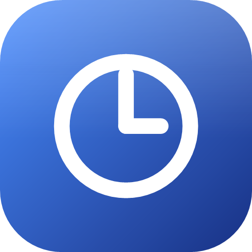
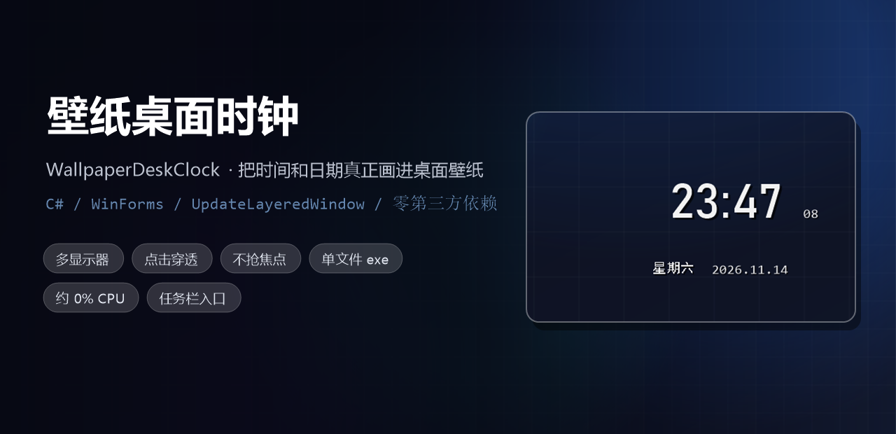
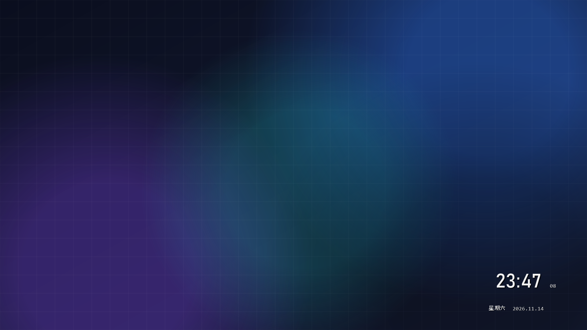
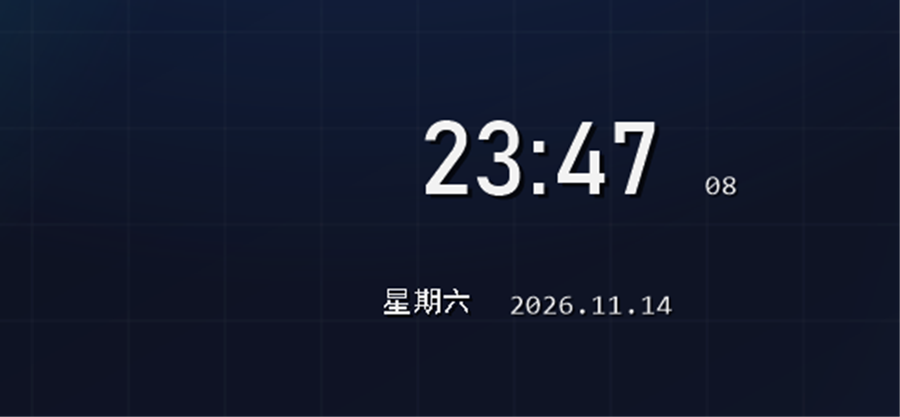
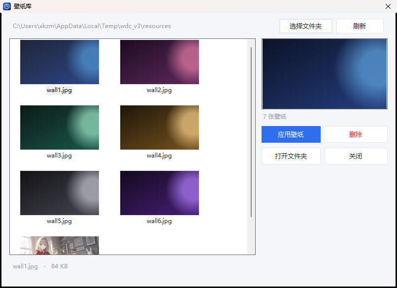
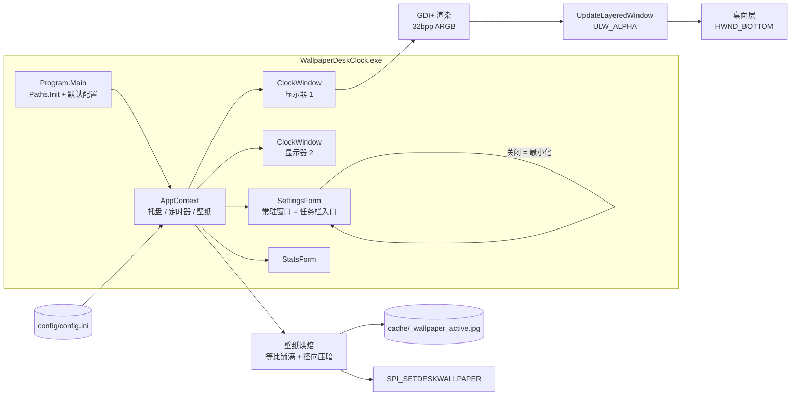
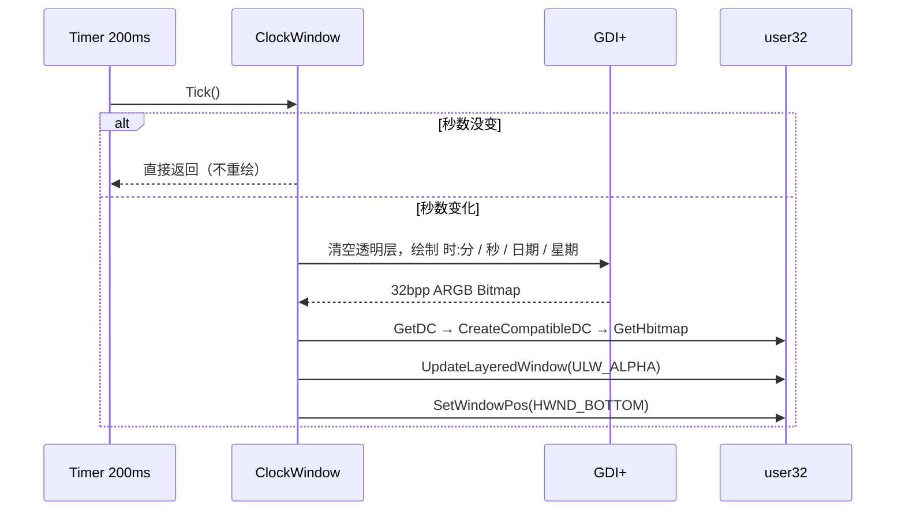

<div align="center">



# 壁纸桌面时钟 · WallpaperDeskClock

**把时间和日期真正画进桌面壁纸 —— 77 KB、零依赖、点击穿透的 Windows 桌面时钟**

[](#-快速开始)
[](#-源码编译)
[](https://github.com/xkzm123/WallpaperDeskClock/releases/latest)
[](#-为什么这么小)
[](#-为什么这么小)
[](LICENSE)
[](https://github.com/xkzm123/WallpaperDeskClock/stargazers)

[效果预览](#-截图) · [快速开始](#-快速开始) · [使用说明](#-使用说明) · [配置详解](#-配置详解) · [目录结构](#-目录结构) · [工作原理](#-工作原理) · [常见问题](#-常见问题)

</div>



---

## 📖 这是什么

桌面时钟满地都是，但绝大多数要么占着一块**不透明的窗口**，要么**挡住图标和右键菜单**，要么为了动画**常驻吃 GPU**。

WallpaperDeskClock 换了个思路：时钟不是「窗口」，而是一层**分层透明窗口（layered window）**。

- 用 GDI+ 把「时:分 / 秒 / 日期 / 星期」画成一张 32bpp ARGB 位图；
- 用 `UpdateLayeredWindow` 以 `ULW_ALPHA` 逐像素推送，**真透明**、边缘抗锯齿，不是抠色；
- 窗口 Z 序钉在 `HWND_BOTTOM`，并带上 `WS_EX_TRANSPARENT | WS_EX_NOACTIVATE | WS_EX_TOOLWINDOW` —— **鼠标点击直接穿透到桌面**，不进 Alt+Tab，不抢焦点；
- 顺手把壁纸重新烘焙一张（等比铺满 + 右下角径向压暗），保证**任何壁纸下文字都清楚**。

结果就是：它看起来像壁纸的一部分，而不是一个趴在桌面上的程序。

而**管理入口**放在你顺手的地方：任务栏一个图标、托盘一个图标，点开就是设置，不占用桌面、不打断时钟。

```text
77 KB 单文件 exe   ·   常驻内存约 40 MB   ·   空闲 CPU 0.0%   ·   无任何第三方依赖
```

---

## 📸 截图

**桌面效果**（1920×1080，右下角默认位置）



**局部特写**：`HH:mm` + 秒 + 日期 + 星期，带柔和的投影



| 设置面板（任务栏图标 / 托盘图标均可打开） | 编辑模式：时间 / 日期可分开拖 |
| :---: | :---: |
|  |  |
| 开机自启、显示器、布局、字号、壁纸库、退出，一屏搞定 | 蓝色框 = 时间块，绿色框 = 日期块，虚线内可直接拖动 |

**壁纸库**：缩略图浏览、预览、一键应用、删除



| 运行状态（自动刷新，含 PID） |
| :---: |
|  |

> 以上均为真实运行截图；数值随系统不同（内存约 35–45 MB，空闲 CPU 0.0%）。

---

## ✨ 特性

| 特性 | 说明 |
| --- | --- |
| 🪟 **真·分层透明** | `UpdateLayeredWindow` + 32bpp ARGB，字体抗锯齿边缘无锯齿、无黑边 |
| 🖱️ **点击穿透** | `WS_EX_TRANSPARENT`，图标、右键菜单、拖选文件全部照常 |
| 🚫 **不抢焦点** | `WS_EX_NOACTIVATE` + `WS_EX_TOOLWINDOW`，不进 Alt+Tab、不打断游戏全屏 |
| 📌 **任务栏入口** | 启动后任务栏常驻一个图标：**最小化出现，桌面不弹窗**；点一下就是设置界面 |
| 🧲 **关闭只留托盘** | 点 ✕ 后窗口与**任务栏图标一起消失**，只留托盘图标，程序继续运行；双击托盘图标即可重开 |
| 🖐️ **跟手拖动** | 自绘拖动（鼠标捕获 + 屏幕坐标差），不再走系统移动环，1 像素跟手、不卡顿 |
| 🧩 **时间 / 日期分开拖** | 编辑模式下可整体移动，也可单独拖动「时间」块与「日期」块，各自记住偏移 |
| 🖼️ **壁纸库** | 指定任意文件夹作为壁纸库，缩略图浏览 + 大图预览 + 一键应用 + 删除 |
| 🌗 **启动不闪** | 首帧在窗口沉到桌面层之后才推送，启动瞬间不会在任何窗口上方闪现 |
| 🎛️ **现代化 UI** | 自绘卡片 / 开关 / 滑块，统一配色与间距，无原生控件堆砌感 |
| 🖥️ **多显示器** | 每块屏一个独立时钟，`all` 或指定第 N 块；拔插显示器 2 秒内自动重建 |
| 📐 **比例坐标布局** | 位置以屏幕百分比存储，换分辨率 / 缩放比例后不跑位 |
| 🎨 **壁纸自动烘焙** | 等比铺满 + 右下角径向压暗（`vignette`），深色浅色壁纸都能看清 |
| 🖐️ **拖动即定位** | 编辑模式拖动，退出编辑自动写回 `config/config.ini`，无需手改坐标 |
| ⚡ **几乎零开销** | 200 ms 心跳，但**只在秒数变化时重绘**；无动画、无 GPU 渲染 |
| 🗂️ **干净的目录** | 根目录只有 exe + 图标 + README，配置/资源/日志/缓存各归其位 |
| 🧷 **自启自愈** | 移动程序目录后，注册表启动项路径会在下次启动时自动改写 |
| 🔁 **单实例** | 命名互斥体，重复启动直接提示，不会叠出两个时钟 |
| 📦 **零依赖单文件** | 只用 .NET Framework 自带的 WinForms + GDI+，`csc` 一条命令出 exe |

---

## 🚀 快速开始

### 方式一：直接运行（推荐）

1. 到 [Releases](https://github.com/xkzm123/WallpaperDeskClock/releases/latest) 下载 `WallpaperDeskClock-v1.2.1-win.zip` 并解压；
2. 双击 `WallpaperDeskClock.exe`；
3. 任务栏出现蓝色时钟图标（**最小化状态**，不会弹窗），桌面右下角出现时钟；
4. 点任务栏图标 / 双击托盘图标 = 打开设置。

> 不需要安装，不需要管理员权限，`.NET Framework 4.x` 是 Windows 10/11 自带的。
> `config/`、`logs/`、`cache/` 会在首次运行时自动创建，`config/config.ini` 也会自动生成。

### 方式二：源码编译

```bat
:: 仓库根目录执行
build\build.bat
:: 产物：WallpaperDeskClock.exe（就在根目录）
```

不想用脚本，一条 `csc` 也能搞定（`WallpaperDeskClock.ico` 缺失时先跑 `build\gen-icon.ps1`）：

```bat
%WINDIR%\Microsoft.NET\Framework64\v4.0.30319\csc.exe /target:winexe /optimize+ ^
  /out:WallpaperDeskClock.exe /win32icon:WallpaperDeskClock.ico ^
  /win32manifest:src\app.manifest ^
  /r:System.dll /r:System.Drawing.dll /r:System.Windows.Forms.dll ^
  src\Program.cs src\AppContext.cs src\ClockWindow.cs src\Dialogs.cs ^
  src\Paths.cs src\AssemblyInfo.cs
```

用 Visual Studio 的话，新建一个 **Windows Forms App (.NET Framework)** 项目，把 `src` 里的 `.cs` 和 `app.manifest` 丢进去即可。

---

## 🕹 使用说明

### 启动后发生什么

| 位置 | 表现 |
| --- | --- |
| 桌面 | 每块显示器右下角一个透明时钟，**点击穿透**，不挡图标操作 |
| 任务栏 | 一个「壁纸桌面时钟」图标（窗口处于最小化，**不弹窗**） |
| 托盘 | 一个同款图标，右键有完整菜单 |

### 三个入口，随你用

- **任务栏图标**：点一下 → 设置界面；再点「关闭」→ 收回任务栏。
- **托盘图标**：双击 → 设置；右键 → 设置 / 资源占用 / 重新应用壁纸 / 恢复默认布局 / 打开配置目录 / 退出。
- **设置面板**：`退出程序` 按钮（带确认框）。

### 自定义布局怎么拖

1. 设置里打开 **自定义布局模式**（开关变蓝）；
2. 时钟窗口会浮到最前并显示虚线框：**蓝色 = 时间块**、**绿色 = 日期块**；
3. 拖任意空白处 = 整体移动；拖蓝色框内 = 只动时间；拖绿色框内 = 只动日期；
4. 松手即写回 `config/config.ini`，关掉开关恢复正常穿透。

### 关闭 ≠ 退出

点设置窗口的 `✕` 或「关闭」按钮：**设置窗口消失，任务栏图标一起消失，托盘图标保留**，时钟继续走。

重新打开：**双击托盘图标**，或右键托盘图标 → **设置…**（此时任务栏图标会重新出现）。

真正退出只有两条路：

1. 设置面板里的 **退出程序**；
2. 托盘右键 → **退出**。

### 进程名是什么？

任务管理器「应用」里显示 **壁纸桌面时钟**，详细信息里的进程名是 **`WallpaperDeskClock.exe`**。

它不是 **桌面窗口管理器（`dwm.exe`）** —— `dwm.exe` 是 Windows 自己的合成器进程，本程序只是把透明窗口贴在桌面上。之所以看起来"混在桌面里"，是因为窗口 Z 序被钉在 `HWND_BOTTOM` 且完全透明穿透，任务管理器里仍然是一个独立的 `WallpaperDeskClock.exe`。

---

## ⚙️ 配置详解

配置文件位置：**`config/config.ini`**（首次运行自动生成，带注释；模板见 `config/config.sample.ini`）。

改完在托盘菜单点 **「重新应用桌面壁纸」** 或重启程序生效；设置面板里的改动会即时生效并自动保存。

### 基础

| 键 | 默认值 | 说明 |
| --- | --- | --- |
| `image` | `resources/wallpaper.jpg` | 背景图路径，相对 exe 目录或绝对路径 |
| `displays` | `all` | `all` = 全部显示器；`0` = 第 1 块；`1` = 第 2 块 |
| `use12h` | `0` | `0` → `HH:mm`；`1` → `hh:mm` |
| `dateformat` | `yyyy.MM.dd` | 任意 .NET 日期格式串，如 `M月d日 ddd` |
| `color` | `#F2F2F2` | 文字颜色，`#RRGGBB` 或 `#AARRGGBB` |
| `shadow` | `1` | 是否绘制投影 |
| `showdate` / `showweek` / `showseconds` | `1` | 分别控制日期 / 星期 / 秒的显示 |

### 壁纸烘焙

| 键 | 默认值 | 说明 |
| --- | --- | --- |
| `vignette` | `1` | 是否把右下角径向压暗烘焙进壁纸 |
| `vignette_alpha` | `78` | 压暗强度（0–255），越大越暗 |

### 布局（一般交给拖动和滑块）

| 键 | 默认值 | 说明 |
| --- | --- | --- |
| `layout.<屏>.x` / `.y` | `0.575` / `0.790` | 时钟窗口左上角占屏幕宽 / 高的比例 |
| `layout.<屏>.scale` | `1.0` | 该屏的整体缩放（设置面板滑块 = 0.50×–2.50×） |
| `layout.<屏>.tdx` / `.tdy` | `0` | 时间块相对默认位置的偏移（占窗口宽高比例，拖动自动写入） |
| `layout.<屏>.ddx` / `.ddy` | `0` | 日期块相对默认位置的偏移 |
| `library` | 空 = `resources/` | 壁纸库目录，可在壁纸管理器里用「选择文件夹」修改 |
| `rel_right` | `0.831` | 文字右对齐点在窗口内的横向比例 |
| `rel_clock_y` / `rel_date_y` | `0.323` / `0.695` | 时间行 / 日期行的纵向比例 |
| `gap_seconds` | `14` | 秒与分钟之间的横向间距（px） |
| `gap_week` | `26` | 星期与日期之间的横向间距（px） |
| `seconds_dy` | `10` | 秒相对时间行的纵向偏移（px） |

### 字体

| 键 | 默认值 | 说明 |
| --- | --- | --- |
| `font_clock` / `size_clock` | `Bahnschrift` / `64` | 主时间字体与字号（px） |
| `font_date` / `size_date` | `Consolas` / `18` | 日期 |
| `font_week` / `size_week` | `SimHei` / `18` | 星期 |
| `font_seconds` / `size_seconds` | `Consolas` / `18` | 秒 |

> 实际字号 = 基础字号 × `layout.<屏>.scale`。字体缺失时自动回退到 `Segoe UI`。

### 换个壁纸

```ini
image=D:\Pictures\my-wallpaper.jpg
```

程序不会改动你的原图，只在 `cache/` 生成 `_wallpaper_active.jpg`（烘焙后的副本）并设为桌面壁纸。

> 截图里用的演示壁纸是 [`docs/demo-wallpaper.png`](docs/demo-wallpaper.png)，可以直接拿去试效果。

---

## 🗂 目录结构

根目录保持干净：**只放 exe、图标、README**，其余按用途分目录。

```text
WallpaperDeskClock/
├── WallpaperDeskClock.exe      # 构建产物（不入库），双击即用
├── WallpaperDeskClock.ico      # 图标：exe / 任务栏 / 窗口 / 托盘
├── README.md
├── LICENSE
├── src/                        # 源码（8 个文件，约 2000 行）
│   ├── Program.cs              # Win32 声明、Config 读写、布局存储、开机自启、入口
│   ├── AppContext.cs           # 托盘、任务栏入口、定时器、多显示器、壁纸烘焙
│   ├── ClockWindow.cs          # 分层透明窗口：渲染 + UpdateLayeredWindow + 拖动
│   ├── Dialogs.cs              # 设置面板、运行状态、自绘滑块
│   ├── WallpaperForm.cs        # 壁纸库：缩略图 / 预览 / 应用 / 删除
│   ├── Ui.cs                   # 配色、圆角卡片、开关、Logo 自绘
│   ├── Paths.cs                # 目录约定 + 自动建目录 + 图标加载
│   ├── AssemblyInfo.cs         # 版本资源（任务管理器显示名）
│   └── app.manifest            # asInvoker + Per-Monitor V2 DPI 感知
├── build/
│   ├── build.bat               # 一键编译 → 根目录 exe
│   ├── gen-icon.ps1            # 生成多尺寸 ico（16–256）
│   └── gen-readme-assets.ps1   # 生成 docs/ 下的 README 配图
├── config/
│   └── config.sample.ini       # 配置模板（运行时用的是 config.ini）
├── resources/
│   └── wallpaper.jpg           # 示例壁纸
├── docs/                       # README 配图
├── logs/                       # 运行时生成：wallpaperdeskclock.log / probe.log
└── cache/                      # 运行时生成：_wallpaper_active.jpg
```

### 运行时目录

| 路径 | 内容 | 谁创建 |
| --- | --- | --- |
| `config/config.ini` | 用户配置（含各屏布局） | 首次运行自动生成 |
| `resources/wallpaper.jpg` | 默认壁纸 | 随包提供 |
| `logs/wallpaperdeskclock.log` | 运行日志（诊断 / 壁纸设置结果） | 自动 |
| `logs/probe.log` | 启动期壁纸权限探针 | 自动 |
| `cache/_wallpaper_active.jpg` | 烘焙后的壁纸副本 | 自动 |

> `logs/`、`cache/`、`config/config.ini` 已在 `.gitignore` 中，不会污染仓库。

---

## 🧠 工作原理

### 整体结构



### 一次刷新的完整链路



### 任务栏入口是怎么做的

不需要额外的宿主进程，也没有第二个窗口：

1. `SettingsForm` 在启动时**只创建一次**，`Show()` 之前先把 `WindowState` 设成 `Minimized`；
2. 于是任务栏立刻出现一个按钮，桌面上却什么都不显示（最小化窗口不占屏）；
3. 用户点任务栏按钮 → Windows 还原窗口 → 就是设置界面；
4. `FormClosing` 里 `e.Cancel = true` + `WindowState = Minimized`，**关闭 = 收回任务栏**；
5. 只有 `ExitApp()` 会把 `exiting` 置真，让窗口真正关闭并退出消息循环。

时钟窗口完全不受影响：它们依然是 `WS_EX_TRANSPARENT | WS_EX_NOACTIVATE | WS_EX_TOOLWINDOW`，不进任务栏、不抢焦点。

### 两个容易踩的坑

1. **分层窗口的透明像素不接收鼠标** —— 这正是以前「拖动迟钝、经常拖不动」的根因：只有文字那几个像素能点中。现在编辑模式下会给整层铺一层 `alpha = 14` 的极淡底色，肉眼几乎不可见，但整个窗口都能命中。
2. **启动闪现** —— 新窗口默认在 Z 序顶部。现在先以「未推送的空图层」显示（完全透明）→ `SetWindowPos(HWND_BOTTOM)` → 再推送首帧，因此内容出现时已经在桌面层。

### 为什么这么小

- 不引第三方包：只用 `System.Windows.Forms` + `System.Drawing` + P/Invoke；
- 不打包运行时：直接吃系统自带的 .NET Framework 4.x；
- 6 个源文件约 1500 行，没有 XAML、没有资源字典、没有 NuGet 还原；
- 62 KB 里还包含了 7 个尺寸的 PNG 图标与版本资源。

---

## ❓ 常见问题

<details>
<summary><b>编辑模式下拖动还是不动？</b></summary>

确认开关是蓝色（已开启）。编辑模式下时钟会浮到最前，窗口内任意位置都能拖动；蓝色虚线框内拖「时间」，绿色框内拖「日期」，其余区域拖整体。
</details>

<details>
<summary><b>壁纸库显示「没有找到图片」？</b></summary>

支持 `jpg / jpeg / png / bmp`，单次最多载入 120 张。点「选择文件夹」换目录，或把图片放进 `resources/`（默认库）。缩略图是即时生成的，不会修改原图。
</details>

<details>
<summary><b>任务管理器里它叫什么？会不会显示成「桌面窗口管理器」？</b></summary>

「应用」列表里显示 **壁纸桌面时钟**，「详细信息」里的进程名是 **`WallpaperDeskClock.exe`**。

`dwm.exe`（桌面窗口管理器）是 Windows 自己的合成器进程，和本程序无关 —— 本程序只是把透明窗口贴在桌面上，所以视觉上和壁纸融为一体。
</details>

<details>
<summary><b>启动后什么都没弹出来，是不是没运行？</b></summary>

这是设计如此：启动时设置窗口是**最小化**的，桌面上只多了一个时钟。

看两个地方：任务栏的蓝色时钟图标、托盘的同款图标 —— 任点一个都能打开设置。
</details>

<details>
<summary><b>点了「关闭」，时钟还在，程序是不是没退？</b></summary>

对，这是有意的：✕ 只是把设置窗口收起来（连任务栏图标一起消失），程序还在托盘里跑。要重新打开就双击托盘图标；要退出请用设置里的 **退出程序**，或托盘右键 → **退出**。
</details>

<details>
<summary><b>日志里出现 <code>设置桌面壁纸 ... 结果=0 err=5</code>，壁纸没变？</b></summary>

`err=5` 是 `ERROR_ACCESS_DENIED`：`SPI_SETDESKWALLPAPER` 被组策略 / 安全软件 / 会话权限拦住了。程序仍会正常显示时钟，只是改不了壁纸。此时手动右键 `cache/_wallpaper_active.jpg` → **设为桌面背景** 即可。
</details>

<details>
<summary><b>时钟不见了 / 拖到屏幕外面了？</b></summary>

托盘右键 → **恢复默认布局**，或设置面板里的同名按钮。程序对拖出屏幕有边界保护（至少留 40 px 在屏内），但极端多屏排列下仍可能跑到别的屏。
</details>

<details>
<summary><b>换了壁纸以后文字看不清？</b></summary>

把 `vignette=1` 打开，并适当提高 `vignette_alpha`（如 `110`）；或把 `color` 换成 `#FFFFFF`、`shadow=1` 保持开启。
</details>

<details>
<summary><b>只想在其中一块屏显示？</b></summary>

`config/config.ini` 里 `displays=0`（第 1 块）或 `displays=1`（第 2 块），也可以直接在设置面板的下拉框里选。
</details>

<details>
<summary><b>开机自启没生效？</b></summary>

自启写的是 `HKCU\Software\Microsoft\Windows\CurrentVersion\Run`，只对当前用户有效。把程序**移动到别的目录**后无需手动改注册表 —— 下次启动会检测路径不一致并自动改写。
</details>

<details>
<summary><b>能不能只留 exe？删掉 config / logs / cache 会怎样？</b></summary>

可以。三个目录都会在下次启动时自动重建，`config/config.ini` 也会按默认值重新生成（`resources/wallpaper.jpg` 缺失时只跳过改壁纸，时钟照常显示）。
</details>

<details>
<summary><b>SmartScreen 提示未知发布者？</b></summary>

exe 未做代码签名，Windows 会对新下载的未签名程序提示。选择「更多信息 → 仍要运行」，或者自己 `build\build.bat` 编译一个。
</details>

---

## 🆚 和其他方案比

| | **WallpaperDeskClock** | Rainmeter | Wallpaper Engine | 系统小组件 |
| --- | :---: | :---: | :---: | :---: |
| 体积 | **62 KB** | ~20 MB | ~200 MB+ | 系统内置 |
| 常驻内存 | **~40 MB** | ~60 MB+ | ~200 MB+ | — |
| 点击穿透 | ✅ | 需配置 | ❌ | ❌ |
| 任务栏入口 | ✅（最小化，不弹窗） | ✅ | ❌ | ❌ |
| GPU 占用 | **无**（纯 GDI+ 静态绘制） | 低 | 中～高（动画） | 低 |
| 学习成本 | 一个 ini | 皮肤语法 | 商店 + 创意工坊 | 无 |
| 付费 | 免费 | 免费 | 付费 | 免费 |
| 定位 | 只要一个不碍事的时钟 | 全能桌面套件 | 动态壁纸 | 固定样式 |

一句话：**如果你只想要一个「长在壁纸上」的时间，别为它装一个平台。**

---

## 🗺 Roadmap

- [x] 任务栏入口 + 独立图标（v1.1.0）
- [x] 目录分层：配置 / 资源 / 日志 / 缓存分离
- [x] 跟手拖动 + 时间 / 日期独立定位 + 启动不闪（v1.2.0）
- [x] 现代化 UI（卡片 / 开关 / 滑块）+ 精简运行状态
- [x] 壁纸库：缩略图 / 预览 / 一键应用 / 删除（v1.2.0）
- [ ] 字体描边 / 可配置阴影颜色与模糊半径
- [ ] 壁纸库支持子目录与定时轮换
- [ ] 农历、节气、节日提醒
- [ ] 秒级平滑淡入（保持 CPU 近零的前提下）
- [ ] GitHub Actions 自动编译 + Release 产物

有想法欢迎开 [Issue](https://github.com/xkzm123/WallpaperDeskClock/issues)。

---

## 📄 License

[MIT](LICENSE) © 2026 xkzm123

<div align="center">

如果这个小工具让你的桌面舒服了一点，点个 ⭐ 就是最好的支持。

</div>
