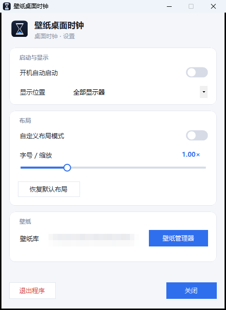
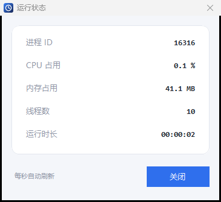

<div align="center">

# 壁纸桌面时钟 · WallpaperDeskClock

**把时间和日期真正画进桌面壁纸 —— 77 KB、零依赖、点击穿透的 Windows 桌面时钟**

[](#快速开始)
[](#从源码编译)
[](https://github.com/xkzm123/WallpaperDeskClock/releases/latest)
[](#)
[](LICENSE)

</div>

## 截图

| 设置 | 运行状态 |
| :---: | :---: |
|  |  |

**壁纸库**：缩略图浏览、预览、一键应用、删除


> 全部为程序真实运行截图；截图中的本地路径已打码。

## 特性

- **真·分层透明**：`UpdateLayeredWindow` + 32bpp ARGB，边缘抗锯齿，不是抠色
- **点击穿透**：`WS_EX_TRANSPARENT`，图标、右键菜单、拖选文件全部照常；不抢焦点、不进 Alt+Tab
- **跟手拖动**：整体 / 时间块 / 日期块分别定位，松手即写回配置
- **多显示器**：每屏独立布局，按屏幕比例存储，换分辨率不跑位
- **壁纸库**：指定任意文件夹，缩略图 + 预览 + 一键应用 + 删除
- **两个入口**：任务栏一个图标、托盘一个图标；关掉设置窗口只留托盘
- **几乎零开销**：200 ms 心跳，只在秒变化时重绘，空闲 CPU ≈ 0%，常驻内存约 40 MB
- **零依赖单文件**：只用 .NET Framework 自带的 WinForms + GDI+，exe 77 KB

## 快速开始

**直接用**：到 [Releases](https://github.com/xkzm123/WallpaperDeskClock/releases/latest) 下载 zip 解压，双击 `WallpaperDeskClock.exe`。
需要 Windows 10/11 + .NET Framework 4.x（系统自带），无需安装、无需管理员权限。

**从源码编译**：

```bat
build\build.bat
:: 产物：根目录 WallpaperDeskClock.exe
```

## 使用

| 操作 | 方式 |
| --- | --- |
| 启动 | 任务栏出现一个最小化图标，桌面右下角出现时钟 |
| 打开设置 | 点任务栏图标，或双击托盘图标 |
| 关闭设置 | 点 `✕`：窗口与任务栏图标一起消失，**托盘图标保留**，时钟继续走 |
| 退出程序 | 设置里的「退出程序」，或托盘右键 → 退出 |
| 自定义布局 | 打开开关后：蓝框内拖「时间」、绿框内拖「日期」、空白处拖整体 |

配置文件：`config/config.ini`（首次运行自动生成，模板见 `config/config.sample.ini`）。

## 配置

| 键 | 默认值 | 说明 |
| --- | --- | --- |
| `image` | `resources/wallpaper.jpg` | 壁纸路径，相对 exe 目录或绝对路径 |
| `displays` | `all` | `all` = 全部显示器；`0` / `1` = 指定第 N 块 |
| `use12h` | `0` | `1` 时用 `hh:mm` |
| `dateformat` | `yyyy.MM.dd` | 任意 .NET 日期格式串 |
| `color` | `#F2F2F2` | 文字颜色 |
| `vignette` / `vignette_alpha` | `1` / `78` | 右下角径向压暗及其强度 |
| `font_clock` / `size_clock` | `Bahnschrift` / `64` | 主时间字体与字号（px） |
| `library` | 空 = `resources/` | 壁纸库目录 |

布局项（`layout.<屏>.x/y/scale/tdx/tdy/ddx/ddy`）由拖动和滑块自动写入，不用手改。

## 目录结构

```text
WallpaperDeskClock/
├── WallpaperDeskClock.exe      # 构建产物，双击即用
├── WallpaperDeskClock.ico      # 图标（exe / 任务栏 / 窗口 / 托盘）
├── README.md · LICENSE
├── src/                        # 源码：Program / AppContext / ClockWindow / Dialogs / WallpaperForm / Ui / Paths
├── build/                      # build.bat 编译脚本 · gen-icon.ps1 图标生成
├── config/                     # config.sample.ini（运行时生成 config.ini）
├── resources/                  # 示例壁纸
├── docs/                       # 本 README 的截图
├── logs/  cache/               # 运行时生成：日志 / 烘焙后的壁纸副本
└── .gitignore
```

## 常见问题

<details>
<summary><b>编辑模式下拖不动？</b></summary>

确认开关是蓝色的。分层窗口的透明像素本来不接收鼠标，程序在编辑模式会给整层铺一层极淡底色，所以窗口内任意位置都能拖；蓝色虚线框内拖「时间」，绿色框内拖「日期」，其余区域拖整体。
</details>

<details>
<summary><b>壁纸库显示「没有找到图片」？</b></summary>

支持 `jpg / jpeg / png / bmp`，单次最多载入 120 张。点「选择文件夹」换目录，或把图片放进 `resources/`（默认库）。
</details>

<details>
<summary><b>日志里出现 <code>设置桌面壁纸 ... 结果=0 err=5</code>？</b></summary>

`err=5` 是权限被拦截（组策略 / 安全软件）。时钟仍会正常显示，只是改不了壁纸；此时手动右键 `cache/_wallpaper_active.jpg` → 设为桌面背景即可。
</details>

<details>
<summary><b>任务管理器里它叫什么？</b></summary>

进程名 `WallpaperDeskClock.exe`，显示名「壁纸桌面时钟」。它不是 `dwm.exe`（桌面窗口管理器是系统进程），只是把透明窗口贴在桌面层。
</details>

## License

[MIT](LICENSE) © 2026 xkzm123
